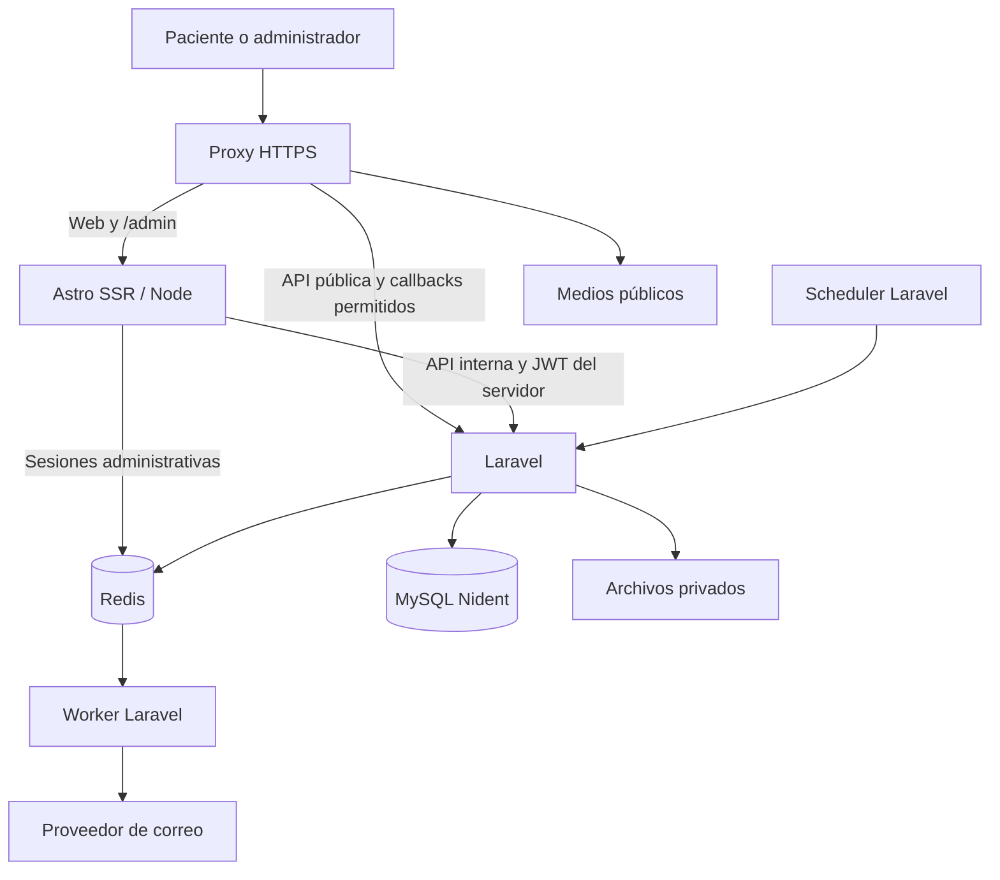

# Fase 0 — Auditoría y arquitectura Nident

Fecha: 19 de octubre de 2026. Estado: diagnóstico entregado; arquitectura propuesta pendiente de aprobación. Esta revisión no modifica la aplicación, la configuración ni los datos operativos. Solo crea documentación e inventarios sin credenciales ni registros personales.

## Decisión principal propuesta

Construir un monolito modular Laravel para negocio y persistencia, con Astro para web y administración. Desplegar ambos bajo un mismo origen HTTPS mediante un proxy inverso. Usar MySQL como autoridad y Redis para sesiones del frontend y trabajo asíncrono. Separar procesos de ejecución, sin dividir el negocio en microservicios.

Preparar una base Nident independiente. Conservar la base heredada como fuente de consulta hasta decidir qué datos se transfieren. No es seguro borrar las migraciones actuales: el esquema conectado y los archivos disponibles no coinciden.

## 1. Evidencia observada

| Elemento | Resultado comprobado | Implicación |
|---|---|---|
| Plantilla | 28 HTML, 7 CSS, 10 JS incluidos los vendor, 119 archivos de imagen en `site/assets/img` | Hay una referencia visual extensa; preservar sus páginas e interacciones |
| Frontend | Astro instalado 7.3.8, bienvenida inicial, configuración vacía, `bun.lock` | La migración Nident todavía no existe en Astro |
| Backend | `composer.lock`: Laravel 10.50.3, JWT 2.3.0, Sanctum 3.3.3 | La presencia de Sanctum no significa que se utilice; API usa JWT |
| Runtime local | Node 22.15.0, Bun 1.4.3, PHP 8.4.16 | PHP efectivo difiere de plataforma Composer 8.2; fijar versiones compatibles |
| MySQL | Conexión de lectura correcta; servidor 8.0.45 | La base existe y contiene información |
| Esquema | 164 tablas, 1.703 columnas, 64 rutinas | El backend depende de más que migraciones PHP |
| Datos, conteos exactos | 5 usuarios, 215 productos, 8 pedidos, 2 mensajes, 4 miembros de equipo | No considerar la base descartable ni asumir que esos datos pertenecen a Nident |
| Migraciones | 243 archivos; 299 entradas aplicadas; 56 aplicadas sin archivo; ningún archivo local pendiente | Un `migrate` no reconciliará las diferencias ni reconstruirá lo que falta |
| Motores | Tablas centrales revisadas en InnoDB; `del_configuracion_delivery` usa MyISAM | Revisar conversión de esta última si se retiene; no asumir transacciones para todas |
| Agenda | No aparecen tablas identificables de sedes, profesionales, citas o retenciones; búsqueda de código sin módulo completo identificado | Crear el dominio de agenda después de comprobar dependencias finales |
| Packs | Controlador/modelo `WebPlan` apuntan a `web_planes`, ausente en BD | No etiquetar el módulo como funcional |
| Tratamientos | `web_servicios` figura en una migración aplicada pero está ausente en BD | Contrastar estructura efectiva antes de crear CRUD |
| Trabajo asíncrono | `.env`: `QUEUE_CONNECTION=sync`; `jobs` no existe; scheduler ejecuta `notificacion:evaluar` | No arrancar worker/scheduler heredados indiscriminadamente |
| Pruebas | Solo tests de ejemplo; `phpunit.xml` no aísla BD | No ejecutar pruebas sobre la conexión heredada por defecto |
| Control de versiones | Raíz y ambos proyectos no se reconocen como repositorio Git | Crear control de versiones y recuperación antes de implementar |

La revisión de BD utilizó PDO y consultas de lectura/metadatos; no arrancó Laravel. Esto evita disparar sincronizaciones, correo o tareas desde proveedores y controladores heredados. No se han abierto datos personales ni valores de pasarelas.

## 2. Hallazgos que condicionan el desarrollo

| Prioridad | Evidencia | Acción requerida |
|---|---|---|
| P0 | `routes/api.php` agrupa CRUD bajo `auth:api`; `AuthServiceProvider` no define policies. En las muestras `WebHeaderController`, `WebPlanesController` y `WebReclamosController` no se observa autorización por operación | Implementar permisos de servidor usando relaciones existentes; verificar denegación para usuario autenticado sin permiso. No extrapolar este hallazgo a cada endpoint sin revisarlo |
| P0 | `FileController::show_reclamo` entrega archivos de `storage/app/public/reclamos`; ruta pública fuera del grupo autenticado | Trasladar documentos sensibles a almacenamiento privado y autorizar su descarga; revisar también el enlace público `/storage` |
| P0 | `LibroReclamosController::web_libro_reclamos_estado` convierte código en ID secuencial y permite buscar solo por documento. Un código sin dígitos no agrega filtro de código | Sustituir consulta por acceso verificable, token aleatorio y límites; impedir que una entrada malformada produzca una consulta general |
| P0 | Ese controlador registra código y documento en logs; `CheckoutController` registra `$request->all()` | Reducir logs a identificadores técnicos y datos permitidos; no transportar estos patrones a Nident |
| P0 comercial | `StripeService::handleWebhook` acepta payload sin firma cuando falta secreto; su confirmación de pedido está comentada | No habilitar Stripe hasta validar firma obligatoria, persistencia, deduplicación y conciliación |
| P0 comercial | `CheckoutController::procesarPedido` cobra antes de comenzar la transacción del pedido y registra explícitamente la posibilidad de cargo sin pedido | Diseñar intento de compra persistente, idempotencia y recuperación antes de habilitar venta; no asumir atomicidad entre proveedor y MySQL |
| P1 | `WebHeaderController::obtener` llama `LiamPageData::syncAndPersistHeaderNav` | No usar directamente como lectura pública de Nident; separar consultas de comandos y evitar reescrituras de navegación al consultar |
| P1 | `CheckAllowedDomains`, `ForceCorsForApi` y `config/cors.php` contienen listas y políticas distintas, con dominios anteriores | Unificar por entorno; el origen no sustituye la autenticación/autorización |
| P1 | Ruta `POST /api/register` apunta a `Api\AuthController::register`, método no encontrado | Retirar o implementar el contrato deliberadamente; no exponer registro administrativo público |
| P1 | `PerfilesController`, `RolesController` y `EnvioService` llaman procedimientos almacenados | Preservar sus dependencias o sustituirlas con consultas equivalentes verificadas; no omitir rutinas de la línea base |
| P1 despliegue | Laravel 10 terminó soporte de seguridad el 4 de febrero de 2025 | Planificar actualización compatible antes de producción, como bloque separado; no ejecutar actualización masiva durante la migración visual |
| P1 | `.env_produccion` existe; `.gitignore` excluye `.env.production`, sin una regla explícita equivalente para ese nombre español | Revisar exclusiones antes del primer commit; no incluir archivos reales de secretos |

No se hizo una explotación ni se ejecutaron operaciones comerciales para demostrar estos riesgos. Se identificaron a partir de rutas y código concretos. Los importes, permisos y concurrencia requieren pruebas de comportamiento en un entorno aislado.

## 3. Arquitectura de aplicación propuesta



### Renderizado y publicación

Propuesta: Astro SSR con el adaptador Node compatible con la versión instalada. Se justifica por el CMS, sus slugs dinámicos, publicación frecuente y administración autenticada. Una publicación confirmada en Laravel se debe ver en la siguiente lectura web sin reconstruir todo el sitio. Inicialmente evitar caché HTML compartida; añadirla después con invalidación por versión y sin contenido privado.

Prerenderizar únicamente páginas independientes de BD. Un texto legal administrable tampoco debe quedar congelado accidentalmente durante el build. Servir CSS, JS e imágenes versionadas con caché larga; formularios, agenda, admin y datos privados con `no-store`.

Cada página Astro consulta servicios tipados en `src/lib/api/`. Los componentes reciben datos y renderizan; no contienen reglas de reserva, precios o acceso a MySQL. Los scripts de interacción se cargan por página para no ejecutar agenda/tienda en todas las rutas.

Ante un fallo de Laravel: mostrar un error recuperable o respuesta 503 según la página. No usar productos o disponibilidad falsos como fallback de una operación real.

### Separación del código

Estructura propuesta, todavía no creada:

```text
Frontend-nident/src/
  layouts/                 # Público y administración
  components/              # Compartidos, home, tratamientos, packs, formularios
  features/                # Interacción agrupada por dominio
  lib/api/                 # Cliente, contratos y tratamiento de errores
  lib/server/              # Sesiones y llamadas privadas; solo servidor
  pages/                   # Rutas públicas, admin y acciones específicas
  middleware.ts            # Protección inicial y cabeceras; permisos finales en Laravel

Backend-nident/app/
  Http/Controllers/Api/V1/  # Controladores delgados por contexto
  Http/Requests/            # Validación y autorización de comandos
  Http/Resources/           # Respuestas públicas y administrativas separadas
  Policies/                # Permisos sobre tablas de seguridad existentes
  Services/Nident/          # Adaptadores para capacidades heredadas
  Domain/Agenda/            # Disponibilidad, retener, confirmar, cancelar, reprogramar
  Jobs/                    # Notificaciones reintentables

infra/                     # Proxy, contenedores y ejecución de procesos
docs/                      # Decisiones, operación y recuperación
```

Crear capas cuando resuelvan una responsabilidad real. No agregar un repositorio abstracto por cada modelo ni renombrar masivamente el motor. Mantener servicios útiles y envolverlos donde sus contratos dependan del cliente anterior.

### Rutas y límites

| Ruta | Dueño | Regla |
|---|---|---|
| `/`, `/tratamientos/*`, `/packs/*`, `/tienda`, `/reservar`, `/contacto` y páginas editoriales | Astro | HTML público consultando API de lectura |
| `/admin/*` | Astro | Sesión protegida, `no-store`, `noindex` |
| `/admin/actions/*` | Astro | Acciones explícitas del panel; protección CSRF y origen; sin proxy arbitrario |
| `/api/v1/public/*` | Laravel | Lectura publicada y formularios/agenda públicos con validación y límites |
| `/api/v1/admin/*` | Laravel por red interna | JWT más permiso y alcance sobre cada operación |
| `/api/v1/webhooks/*` | Laravel | Allowlist del proxy, firma del proveedor, deduplicación |
| `/media/*` | Medios públicos | Solo recursos aprobados para publicación |
| Descargas privadas | Laravel | Autorización o enlace temporal de alcance mínimo |

El proxy no publicará un comodín hacia todas las rutas heredadas de Laravel. Durante la transición habrá una lista explícita de endpoints necesarios, ampliada por módulo. Desactivar la SPA administrativa antigua y su redirección a `:5173` al activar `/admin` Astro. Definir mapa de redirecciones sin mezclar reserva y contacto.

### Autenticación elegida para la propuesta

Reutilizar JWT y flujos de OAuth/2FA que se verifiquen, mediante una capa de servidor Astro. El navegador recibe un ID de sesión opaco en cookie `HttpOnly`, `Secure` y `SameSite`; las credenciales JWT y refresh permanecen en el servidor, asociadas a esa sesión en Redis y con acceso restringido. Rotar sesión tras login y elevación de privilegios, revocar en logout y fijar duración administrativa razonable.

Las acciones Astro validan CSRF y origen antes de llamar a Laravel; Laravel comprueba usuario activo, permiso y propiedad del recurso en cada solicitud. El rol mostrado por el panel no concede autoridad por sí solo. Las lecturas administrativas protegidas tampoco se cachean.

OAuth requiere conservar estado y PKCE cuando aplique, verificar redirect URI y completar el intercambio del lado servidor. No reutilizar duraciones de refresh de hasta 365 días como política administrativa sin revisión.

## 4. Matriz de plantilla y módulos

Estado de las filas: evidencia estática y presencia de tablas; no equivale a validación funcional por HTTP. El inventario `fase0/paginas.json` contiene las 28 páginas individualmente y sus selectores reales.

| Página/bloque | Selector real | Backend observado | Estado | Acción principal | Admin y BD |
|---|---|---|---|---|---|
| Compartidos | `.site-header`, `.n-nav`, `.foot`, `.back-to-top` | Header, footer, favicon, medios y WhatsApp | Parcial, marca heredada y lectura con efectos | ADAPTAR | Configuración/navegación; reutilizar tablas, validar campos y permisos |
| Tratamientos, índice | `.n-page-intro`, `#planes` | Migración `web_servicios`, tabla ausente | No operativo | CREAR | Tratamientos; estructura normalizada y contenido editorial |
| Ocho especialidades | `.treatment-hero`, `#que-es`, `#opciones`, `#proceso`, `#cuidados`, `#preguntas`, `.treatment-article`, `.related-reading` | FAQ y contenido genérico disponibles | Parcial | ADAPTAR | Tratamientos y bloques; FK de FAQ según compatibilidad |
| Nosotros | `.about-intro`, `.values-strip`, `#experiencia`, `#espacios`, `.clinic-principles`, `#sedes` | Página nosotros y equipo existentes | Parcial | ADAPTAR | Institucional, galería y sedes |
| Promociones | `.pack-catalog` | Promociones comerciales existentes; `web_planes` ausente | Parcial | ADAPTAR | Separar packs de descuentos de producto |
| Seis packs | `.pack-hero`, `#incluye`, `#para-ti`, `#visita`, `#dudas`, `.pack-end` | `WebPlan` existe, tabla destino ausente | No operativo | CREAR | Packs con slug, contenido, restricciones y enlace a tratamientos |
| Tienda | `.store-intro`, `.cart-panel` | Catálogo, stock, carrito y pedidos heredados | Parcial | ADAPTAR | Reutilizar catálogo y pedidos; reemplazar JSON local y revisar API de carrito |
| Cuidados | `.care-editorial`, `.final-cta` | Publicaciones genéricas identificadas | Parcial, compatibilidad pendiente | ADAPTAR | Contenido educativo; reutilizar si el esquema admite el contenido |
| Reserva, `contacto.html` | `#booking-form`, `.booking-summary`, `.booking-faq` | Diseño PostgreSQL de referencia, demo en JS | Agenda real no identificada | CREAR | Agenda, recursos, horarios y citas MySQL |
| Contacto, `contactanos.html` | `.contact-hero`, `.contact-layout`, `#inquiry-form` | Mensajes persistidos, envío síncrono y redirect Blade | Parcial | ADAPTAR | Atención/mensajes; API JSON y notificación posterior |
| Reclamaciones | `#claim-form`, `#claim-receipt`, `.claim-aside` | `web_reclamos`, recepción y administración | Parcial, acceso inseguro | ADAPTAR | Recepción, auditoría y anexos privados |
| Estado de reclamo | `#claim-search`, `.status-layout` | Consulta secuencial pública | Parcial, rediseñar acceso | ADAPTAR | Consulta verificable; no buscar públicamente por DNI solo |
| Privacidad, términos y cookies | `.legal-intro`, `#legal-*`, `[data-cookie-settings]` | Legales heredados y consentimiento local | Parcial | ADAPTAR | Documentos publicados y preferencias ajustadas a proveedores reales |
| Mapa del sitio | `.n-page-intro` | Rutas actuales mezcladas | Parcial | CREAR | Derivar enlaces públicos publicados; sitemap XML distinto |
| Admin Astro | No existe interfaz Nident | Endpoints y permisos heredados | No existe frontend | CREAR | CRUD por módulo con policies |
| SPA anterior y módulos ajenos | Rutas heredadas | Campus, imprenta, masajes, cotizaciones y otros | Fuera del alcance público | DESACTIVAR | Revisar exposición y tareas; preservar dependencias antes de retirar |

### Inicio, en el orden real

| Selector | Fuente candidata | Acción | Editor |
|---|---|---|---|
| `.n-hero` | Sliders y medios | ADAPTAR | Inicio/banner, textos, imágenes y enlaces |
| `#planes` | Packs; `web_planes` debe resolverse | CREAR | Selección y orden de packs |
| `#tratamientos.care-studio` | Tratamientos y contenido visual | CREAR | Especialidades y selección inicial |
| `.clinic-section` | Institucional/nosotros | ADAPTAR | Presentación de clínica |
| `.family-section` | Bloques editoriales | CREAR | Contenido por público |
| `.kids-feature` | Tratamiento infantil y medios | ADAPTAR | Nident Kids |
| `.comparison-section` | Sin fuente específica demostrada | CREAR | Comparación editorial, sin promesas clínicas inventadas |
| `#por-que-nident` | `web_porque_elejirnos` | ADAPTAR | Beneficios verificados |
| `.specialist-section` | `web_nuestro_equipo` | ADAPTAR | Selección editorial de profesionales |
| `.shop-preview` | `administracion_producto` | CONECTAR | Productos dentales destacados |
| `#aprende` | Publicaciones/cuidados | ADAPTAR | Contenido educativo |
| `.care-gallery` | Medios y galería | ADAPTAR | Imágenes y textos alternativos |
| `#testimonios` | `web_testimonios` | ADAPTAR | Reseñas; demo identificado hasta validación |
| `#comunidad` | Configuración de redes y medios | ADAPTAR | Enlaces oficiales y piezas públicas |
| `.care-journey` | Sin fuente específica demostrada | CREAR | Pasos de atención |
| `.final-cta` | Configuración compartida | ADAPTAR | CTA y destino |

Agrupar bloques editoriales de inicio en una estructura validada por tipo, con posición y publicación. No crear una tabla independiente para cada frase ni permitir HTML libre. Los registros de tratamientos, profesionales y packs deben conservar su identidad fuera de los bloques del home.

### Diferencias que no deben perderse

La plantilla usa Inter y Plus Jakarta Sans, marca violeta, fotografías e ilustraciones dentales, movimiento GSAP, pausa global y respeto de movimiento reducido. Conserva la misma dirección visual. La división de componentes y carga de scripts cambiará, pero se compararán capturas de referencia antes y después.

`contacto.html` es reserva; `contactanos.html` es contacto general. Propuesta: `/reservar` y `/contacto` respectivamente. Las ocho especialidades usarán `/tratamientos/{slug}` y los seis packs `/packs/{slug}`. Mantener selección por `?sede=...` y enlaces a packs al entrar en reserva.

Los `fetch` observados en la plantilla cargan archivos JSON locales de productos y packs; no son llamadas de negocio al backend. Reclamaciones y agenda se sostienen en almacenamiento del navegador. Es necesario sustituir su autoridad, no limitarse a cambiar la extensión `.html` por `.astro`.

## 5. Datos de agenda y contenido propuestos

El esquema final se definirá en migraciones solo después de aceptar esta arquitectura y cruzar las dependencias retenidas.

| Dominio | Estructuras necesarias | Reutilización |
|---|---|---|
| Contenido | Bloques de página tipados, estado de publicación, orden, medios | Reutilizar header, footer, medios, SEO y contenido compatible |
| Tratamientos | Slug único, nombre, descripción, duración operativa independiente del texto, bloques editoriales, publicación | Resolver ausencia real de `web_servicios`; no renombrar productos a tratamientos |
| Packs | Slug, contenido, inclusiones, restricciones, vigencia, relación con tratamientos | Evaluar recuperar `web_planes` ampliada; no construir tabla paralela si la recuperación resulta suficiente |
| Sedes | Identidad, estado operativo, dirección y zona horaria | Sedes demo no habilitadas automáticamente |
| Profesionales | Perfil operativo, especialidades y asignaciones de sede | Relacionar con `web_nuestro_equipo` para presentación; evitar copiar identidades |
| Recursos | Profesionales y consultorios exclusivos | Tabla padre de recursos bloqueable para serializar escrituras |
| Disponibilidad | Turnos, excepciones, descansos y bloqueos | Datos reales pendientes |
| Reservas | Intervalo UTC, estado, vencimiento, propietario, clave de idempotencia y relación con recursos | Nuevo dominio; datos personales mínimos y separados de disponibilidad pública |
| Auditoría | Actor, operación, identificador, transición y tiempo | Reutilizar auditoría compatible; no incluir documentos o mensajes completos en logs |

### Exclusión de agenda con MySQL

Propuesta inicial: serializar todas las escrituras de cada recurso sobre una fila padre existente de `agenda_recursos` usando `SELECT ... FOR UPDATE` dentro de una transacción. Adquirir todos los recursos por ID en un orden estable, luego leer los intervalos ocupados actuales con lectura bloqueante y comprobar `inicio_existente < fin_solicitado AND fin_existente > inicio_solicitado`.

La comprobación incluye citas activas y retenciones aún vigentes. El servidor controla duración y vencimiento. Los intervalos adyacentes son válidos. No basta bloquear una consulta vacía de citas. Toda entrada, incluida edición administrativa, cancelación y limpieza, usa el mismo servicio y protocolo de bloqueos; credenciales de aplicación sin acceso externo de escritura.

Confirmar exige propietario correcto y retención vigente. Una clave de idempotencia única por actor/operación y un hash de petición impiden reutilizar la misma clave con otro contenido. Reprogramar bloquea la unión de recursos anteriores y nuevos antes de modificar, manteniendo la cita original si falla la nueva asignación. Reintentar deadlocks de forma acotada.

Los recursos se bloquean completos durante una transacción breve, evitando depender de la granularidad de cinco minutos o de índices de exclusión PostgreSQL. Esto puede limitar concurrencia por profesional, aceptable como punto de partida para una clínica; medir antes de optimizar. No hacer llamadas de correo o red dentro de los bloqueos.

Pruebas obligatorias: carrera de dos conexiones reales MySQL; solapamiento parcial; mismo consultorio con profesionales distintos; intervalo adyacente; expiración; doble confirmación; reprogramación fallida; retry con la misma clave; primer profesional disponible sin crear un recurso ficticio.

## 6. Migraciones y línea base

El inventario de archivos clasifica provisionalmente 138 migraciones transversales o por revisar, 63 de otros módulos/clientes, 10 Liam, 25 Valento y 7 Rossety. Clasificar por nombre no autoriza su eliminación. Cada archivo incluye operaciones de esquema detectadas, tablas de datos y uso de SQL crudo.

La lista exacta de 56 migraciones aplicadas sin archivo está en `fase0/esquema-observado.json`. Incluye estructuras posteriores de checkout, newsletter, contenido y seguimiento de stock; no son exclusivamente cambios cosméticos. Existen migraciones de creación aplicadas para tablas que ya no están, como `web_planes`. La tabla `migrations` tampoco es prueba del esquema actual.

Secuencia propuesta:
1. Crear Git y excluir secretos, vendor, node_modules, uploads y artefactos antes del primer commit. Guardar una referencia del estado inicial.
2. Verificar un respaldo restaurable de base y archivos. El JSON de metadatos de esta auditoría NO es un backup ni sustituye DDL completo.
3. Mantener intacta la base conectada. Crear una base Nident aislada con usuarios separados de administración y aplicación.
4. Elegir módulos retenidos, comparar el esquema efectivo con modelos y llamadas a rutinas. Elaborar DDL e índices completos y revisar los `DEFINER` de rutinas si se preservan.
5. Construir una línea base Nident desde estructura revisada, sin importar productos, pedidos, credenciales, tokens ni configuraciones del cliente anterior automáticamente.
6. Llevar seeds propios e idempotentes para configuración mínima, menú y contenido demo identificado. Crear el primer administrador mediante un mecanismo explícito, sin contraseña fija en Git.
7. Probar instalación desde cero y segunda ejecución de seeds. Migraciones posteriores serán incrementales.
8. Una vez verificadas las dependencias, archivar el historial heredado fuera del directorio ejecutable; retirar archivos redundantes con manifiesto de correspondencia. No borrar el historial aplicado de la base antigua.

Los módulos que se conserven para uso futuro deben quedar incluidos en la línea base o en extensiones instalables documentadas. No dejar controladores que aparenten disponibilidad si sus tablas se han eliminado.

Si el usuario decide reutilizar la misma base, cambia esta estrategia: primero recuperar o conciliar el historial y aplicar únicamente migraciones incrementales. Esa elección no implica permiso para destruirla.

## 7. Marca y medios

Inventario automático: 155 archivos de aplicación/configuración/rutas/vistas/seeders con alguna marca anterior. `fase0/marcas-archivos.json` lista rutas y marcas sin valores de configuración. La clasificación VISIBLE/CONFIGURACIÓN/INTERNO debe resolverse en cada cambio; no se propone un replace global.

Ejemplos verificados: bienvenida API Valento; fallback de logo en `WebHeaderController`; `ContactoValento`; agregadores Rossety/Liam; fallback editorial de equipo que menciona marketing digital; dominios en CORS; remitente Valento en contacto. Las migraciones conservan contenido de clientes anteriores y se tratan mediante la estrategia de línea base.

Mantener inicialmente `site/assets/img` y sus 119 imágenes. `logo1-trim.webp` es el logo enlazado en la plantilla. Preparar favicon y variantes desde activos de marca verificados. Las carpetas heredadas de `public/` incluyen `rossety`, `temp`, `temp02`, `favicon`, `imagenes` y `storage_`: no se autoriza eliminar ninguna completa.

Antes de retirar medios: cruzar código, CSS, JSON, columnas URL/JSON de BD, librería de medios y contenido enriquecido. Este cruce completo de referencias de medios en BD queda pendiente; todavía no existe lista de imágenes demostradas sin uso.

Contenido oficial pendiente: razón social y RUC, direcciones operativas, teléfono/WhatsApp, correo y destinatarios, perfiles sociales, profesionales acreditados, horarios, duración de tratamientos, precios, stock y políticas operativas. `hola@nident.example` y reseñas/precios demo no se convierten en datos oficiales al migrar.

## 8. Operación y DevOps propuestos

### Entornos y procesos

- Desarrollo, staging y producción con bases, Redis, uploads, dominios y credenciales independientes.
- Base de despliegue: host Linux con contenedores o procesos equivalentes; proxy HTTPS, Astro Node, PHP-FPM Laravel, worker, scheduler, MySQL y Redis. Una misma imagen Laravel para API/worker/scheduler, con comandos distintos.
- No asumir cPanel por los documentos heredados. La propuesta SSR necesita ejecutar Node permanentemente. Si el alojamiento no lo permite, revisar arquitectura antes de prometer publicación CMS inmediata.
- Mantener puertos MySQL/Redis/PHP privados; publicar solo el proxy. Usuarios de servicio sin privilegios de DDL en operación normal; credencial de migración separada.
- Variables reales fuera de Git; ejemplos con valores vacíos. Rotar secretos heredados antes de reutilizar servicios externos. No copiar `.env_produccion` al nuevo entorno.
- Cola asíncrona con reintentos y registro de fallos; encolar después de commit. Para notificaciones que no deban perderse entre commit y enqueue, usar outbox transaccional y despacho idempotente.
- Un solo scheduler activo; vencimiento de retenciones también evaluado por el camino transaccional, sin depender de que el cron llegue a tiempo.

### CI y entrega

1. Instalar dependencias usando lockfiles congelados: Bun en frontend, Composer en backend. Mantener el pnpm backend solo si sus assets todavía lo requieren.
2. Verificar tipos/compilación Astro, sintaxis/estilo PHP y auditoría de dependencias. Fijar versiones de runtime compatibles; planificar actualización de Laravel con pruebas de regresión.
3. Levantar MySQL aislado para permisos, integridad, agenda, pedidos y migraciones. No usar SQLite como prueba de bloqueos MySQL.
4. Crear esquema desde cero, ejecutar seeds dos veces y comprobar contratos API. Probar migración desde un snapshot saneado cuando se retengan datos.
5. Ejecutar smoke tests públicos y administrativos, pruebas de denegación y validación visual responsive.
6. Construir artefactos inmutables identificados por commit. Desplegar primero en staging; comprobar salud y luego promover el mismo artefacto.
7. Migraciones mediante un único proceso y estrategia expandir/migrar/contraer. No ejecutar `migrate:fresh` en despliegue.
8. Comprobar salud y smoke tests; disponer de reversión del artefacto. Un rollback de código no revierte automáticamente cambios incompatibles de BD: mantener compatibilidad o preparar recuperación específica.

### Supervisión y recuperación

- Endpoints separados de vida y disponibilidad. La disponibilidad verifica dependencias esenciales con timeout y no expone detalles del entorno.
- Logs estructurados con request ID, errores y tiempos; sin JWT, contraseñas, cuerpos íntegros de solicitud, DNI ni texto clínico.
- Alertas por errores HTTP, saturación, worker detenido, jobs fallidos, retenciones anómalas y discrepancias de pago. Umbrales tras medir staging.
- Copias cifradas de MySQL y medios privados fuera del host, retención definida y pruebas periódicas de restauración. Propuesta inicial a validar: recuperación puntual mediante binlogs, RPO de 15 minutos y RTO de 4 horas; no son garantías actuales.
- Antes de producción, ejecutar un simulacro de restauración completo y documentar responsables y pasos. Ningún backup se considera válido solo porque el archivo existe.
- No se necesita Kubernetes ni servicios independientes por módulo para el alcance demostrado.

## 9. Verificaciones realizadas y límites

| Verificación | Resultado |
|---|---|
| Conexión MySQL y lectura de esquema | OK |
| Cruce de nombres de migraciones con historial aplicado | OK; discrepancia documentada |
| Inventario de 28 HTML, selectores y scripts | OK |
| Lectura de 7 CSS y 10 JS de plantilla | OK; comparación visual en navegador pendiente |
| Sintaxis de los 8 scripts propios mediante `node --check` | OK |
| Sintaxis de 8 archivos PHP críticos mediante `php -l` | OK |
| Build Astro de Nident | PENDIENTE; todavía es el starter, no demuestra migración |
| Pruebas Laravel funcionales | PENDIENTE; primero aislar conexión de pruebas |
| Reserva central y carreras MySQL | PENDIENTE DE IMPLEMENTACIÓN |
| Seguridad por rol y descarga privada | FALLA EN MUESTRAS ESTÁTICAS; corrección y pruebas pendientes |
| Pago sandbox de Nident | BLOQUEADO para activación: configuración propia y correcciones necesarias |
| Instalación de línea base desde cero | PENDIENTE DE CONSTRUCCIÓN |
| Validación de despliegue y restauración | PENDIENTE; no se ha accedido a hosting ni servicios externos |

No se enviaron correos, no se probaron credenciales de terceros, no se iniciaron tareas heredadas, no se borraron archivos de aplicación y no se ejecutaron migraciones.

## 10. Orden de implementación y decisión pendiente

1. **Fundación:** Git/exclusiones, entorno de pruebas separado, restauración de respaldo en aislamiento y decisión de base Nident independiente.
2. **Arquitectura ejecutable:** proxy local, Astro SSR, cliente API, sesión administrativa, endpoint de salud, API versionada y autorización con un primer permiso probado.
3. **Primer bloque vertical:** header, footer y hero Nident con lectura pública sin escrituras, editor administrativo y publicación comprobada; conservar diseño.
4. **Contenido:** tratamientos, packs, nosotros, equipo/sedes y cuidados con CMS correspondiente.
5. **Operación:** agenda MySQL, contacto, reclamaciones y notificaciones; pruebas de concurrencia y acceso.
6. **Comercio:** catálogo dental y flujo de pedidos con idempotencia/conciliación, después pagos sandbox.
7. **Preparación de producción:** Laravel soportado, seguridad, CI, recursos, SEO, visualización responsive y recuperación ensayada.

Decisión recomendada para aprobar la siguiente fase: **Astro SSR + Laravel modular, mismo origen HTTPS, base Nident independiente, conservar base heredada y consolidar estructura tras restauración verificada.** El proveedor de hosting, dominio, cuentas externas y datos oficiales pueden resolverse antes de sus hitos sin frenar el desarrollo local.

El prompt aportado exige entregar la Fase 0 y esperar su aprobación antes de modificar la aplicación. Este documento es el resultado concreto que se somete a esa revisión; la siguiente fase no ha comenzado.

## Referencias técnicas

- [Astro: renderizado bajo demanda y adaptadores](https://docs.astro.build/en/guides/on-demand-rendering/) — fundamento de la propuesta SSR y sus requisitos de runtime.
- [Laravel 10: política de soporte](https://laravel.com/docs/10.x/releases#support-policy) — fecha de fin de soporte y versiones PHP admitidas por esa rama.
- [MySQL: lecturas con bloqueo](https://dev.mysql.com/doc/refman/8.4/en/innodb-locking-reads.html) — fundamento de exclusión con transacciones; la estrategia debe verificarse en el MySQL real del entorno.
